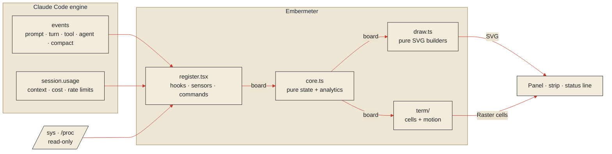

<a id="top"></a>
<p align="center">
  
</p>

<p align="center">
  <a href="https://github.com/X-Saikat-93/embermeter/actions/workflows/ci.yml"></a>
  <a href="https://github.com/X-Saikat-93/embermeter/releases"></a>
  <a href="https://github.com/X-Saikat-93/embermeter/actions/workflows/codeql.yml"></a>
  <a href="https://scorecard.dev/viewer/?uri=github.com/X-Saikat-93/embermeter"></a>
  <a href="https://github.com/X-Saikat-93/embermeter/commits/main"></a>
  <a href="LICENSE"></a>
</p>

<p align="center">
  
  
  
  
  
  
</p>

<p align="center">
  <a href="https://github.com/X-Saikat-93/embermeter/stargazers"></a>
  <a href="https://github.com/X-Saikat-93/embermeter/discussions"></a>
  <a href="https://github.com/X-Saikat-93/embermeter/issues"></a>
  <a href="CONTRIBUTING.md"></a>
</p>

<p align="center">
  <a href="#install"><b>I</b> Install</a> &nbsp;·&nbsp;
  <a href="#instruments"><b>II</b> Instruments</a> &nbsp;·&nbsp;
  <a href="#tour"><b>III</b> Tour</a> &nbsp;·&nbsp;
  <a href="#controls"><b>IV</b> Controls</a> &nbsp;·&nbsp;
  <a href="#workings"><b>V</b> Workings</a> &nbsp;·&nbsp;
  <a href="#safety"><b>VI</b> Safety</a> &nbsp;·&nbsp;
  <a href="#notes"><b>VII</b> Notes</a> &nbsp;·&nbsp;
  <a href="#bench"><b>VIII</b> Workbench</a>
</p>

> **Operator's note.** A model working in your editor burns three things at once: **context**, **money** and **your machine**. Embermeter puts all three on one warm, quiet panel beside the chat. It shows what Claude is doing right now, what it has cost, and how many turns remain before the window compacts. When the CPU runs hot, it holds the heavy jobs until the ember cools.
>
> It's one folder that Claude Code loads, with no server, no network and no dependencies.

<table>
  <tr>
    <td width="33%" valign="top">
      <h4>◐ &nbsp;Forecasts</h4>
      <sub>Turns left before auto-compact, cost per hour against your budget, and a countdown on every rate-limit window.</sub>
    </td>
    <td width="33%" valign="top">
      <h4>◎ &nbsp;Explains</h4>
      <sub>What fills the context, which tools are slow, which files churn, and an A–F health grade with its reasons.</sub>
    </td>
    <td width="33%" valign="top">
      <h4>◆ &nbsp;Protects</h4>
      <sub>A heat guard that holds builds, tests and installs while the CPU runs hot or the battery runs low.</sub>
    </td>
  </tr>
</table>

<a id="install"></a>
<p align="center"></p>

You need **Claude Code 2.1.287 or later**.

<table>
  <tr>
    <td width="33%" valign="top"><b>1 · Install</b><br><sub>One command, from Claude Code in a terminal or from VS Code's terminal (below). It adds the marketplace and installs for <i>you</i>, in every project.</sub></td>
    <td width="33%" valign="top"><b>2 · Start a session</b><br><sub>Open a new chat. The panel opens on its own, and <code>/embermeter</code> brings it back at any time.</sub></td>
    <td width="33%" valign="top"><b>3 · Make it yours</b><br><sub>Theme, budgets, quiet hours and the heat guard are settings. See <a href="#controls">IV · Controls</a>.</sub></td>
  </tr>
</table>

**Claude Code in a terminal.** In any session:

```
/plugin install embermeter --marketplace X-Saikat-93/embermeter
```

Answer `y` to add the marketplace, then choose **User** scope.

**VS Code extension.** The chat panel has no `/plugin` command, but the extension ships the Claude Code CLI. Open VS Code's terminal (<kbd>Ctrl</kbd>+<kbd>`</kbd>) and run, on Linux or macOS:

```sh
"$(ls -d ~/.vscode/extensions/anthropic.claude-code-*/resources/native-binary/claude | sort -V | tail -1)" \
  plugin install embermeter --marketplace X-Saikat-93/embermeter --scope user
```

If you have the CLI on your `PATH` (`npm install -g @anthropic-ai/claude-code`), on any OS including Windows, it's simply:

```sh
claude plugin install embermeter --marketplace X-Saikat-93/embermeter --scope user
```

Then open a new chat. The "userConfig options not yet set" note after installing is fine: every option has a default.

<details>
<summary>Update, check or remove</summary>
<br>

With `claude` as above:

```sh
claude plugin marketplace update embermeter   # fetch the latest release
claude plugin update embermeter@embermeter    # move the installed plugin to it
claude plugin list                            # is it installed and enabled?
claude plugin uninstall embermeter@embermeter # remove it
```

Start a new chat after an update.
</details>

<p align="right"><sub><a href="#top">↑ back to contents</a></sub></p>

<a id="instruments"></a>
<p align="center"></p>

Most dashboards report what the agent already did. Embermeter also **forecasts** what comes next, **explains** its readings, and **protects** the machine underneath.

<p align="center"></p>

<details>
<summary><b>The sixteen instruments, in words</b></summary>
<br>

| | Instrument | What it tells you |
|---:|---|---|
| 01 | **Runway to compact** | Learns how much context each turn uses, counts the turns left before auto-compact, and warns two turns out. |
| 02 | **Context composition** | Messages, system tools, MCP tools, system prompt, memory files, skills and agents, with the compaction line marked. Also every always-loaded file and MCP tool, with its token cost. |
| 03 | **Health grade** | One A–F score from context headroom, tool errors, temperature, denials, rate limits, budget and loops, with the reasons beside it. |
| 04 | **Cache analytics** | Fresh input, cache read, cache write and output tokens. Also cache-hit rate, output speed, and the model behind every turn. |
| 05 | **Cost burn** | Session cost, cost per hour and per turn, and an optional budget with a red line, alerts at 50%, 80% and 100%, and the turns left before it runs out. |
| 06 | **Rate limits** | Every window, how full it is, and a countdown to its reset, or, when it's filling faster, the time until it's full at this pace, with an alert 30 minutes out. |
| 07 | **Live flow** | Prompt → Model → Gate → Tools → Subagents. Particles move only along links that are working. |
| 08 | **Tool leaderboard** | Calls, the context each tool fed back, success and failure split, average and p95 duration, and the slowest calls. |
| 09 | **File heatmap** | Every file read, edited or written, tinted by how much it changed. |
| 10 | **Subagent swimlanes** | Each subagent on a time grid with its model, duration, tools and outcome. Click one to open its transcript. |
| 11 | **Heat guard** | Holds heavy Bash jobs (builds, tests, installs, Docker…) while the CPU stays over its limit or the battery is low; a single spiky reading does not count. It judges each command by its own words, so `grep test` or a commit message about a build stays light. Optional: pause on battery, and a memory limit. Claude is told why. |
| 12 | **Session report** | A one-click Markdown report, plus totals across every session. An optional meter scores how often commands use a wrapper like `rtk`. `/embermeter card` copies a shareable session card. |
| 13 | **Loop watch** | Spots the same call three times in a row, or the same call failing three times, and tells you before the tokens burn. A turn that runs past `longTurnMin` gets a nudge too, with what it was last doing. |
| 14 | **Context fed by tools** | Estimates how many tokens each tool's results put back into the window, so you know whether `Read`, `Bash` or a web fetch is filling it, and which files fed the most. |
| 15 | **Cost waterfall** | Each turn stacked on the running total, colour-coded, with the budget line, plus cost and tokens split by model. |
| 16 | **Thirty days** | A calendar of daily spend and turns, from totals kept on your machine, with an optional daily budget and the last seven days against the seven before. |
| 17 | **Why it costs what it does** | The priciest recent turn and what fed it (files and tools, by tokens), with plain tips: files read again, a tool flooding the context, a cold cache, a full window. |
| 18 | **Read again** | Files read more than once, and the tokens those repeats cost. |
| 19 | **Failing in a row** | Tools whose latest calls failed back to back, with the input that failed. |
| 20 | **Session history** | Your last 20 sessions: grade, length, turns, tool calls, cost and branch. |
| 21 | **Turn-cost stop and loop breaker** | Opt-in guards: refuse tool calls once one turn passes a cost, or a third identical call in a row, so Claude stops and asks instead of burning tokens. |
| 22 | **Cache warmth** | A countdown from each reply to when the prompt cache goes cold, in the strip, the header and the status line. It learns when your account caches for an hour. Optional: a toast a minute before (`cacheAlert`). |
| 23 | **Loaded, never called** | MCP servers whose tools sit in every request but were not called, with their tokens and how many sessions in a row they have gone unused. |
| 24 | **Same tokens, cheaper model** | The main thread's turns repriced at Sonnet 5.5 and Haiku 5.5 list prices, against what they cost. Turns that ran subagents are left out. |
| 25 | **Last compaction** | Tokens before and after the last compaction, and the files and tools that had been feeding the window. |
| 26 | **Test runs** | Passed and failed counts from each test command (Jest, Vitest, pytest, Mocha, cargo, go, node), with the failing trend. |
| 27 | **By branch** | Spend, sessions and turns per git branch, across sessions. |
| 28 | **Background jobs** | Commands Claude ran in the background, until they end or are stopped, with an alert when one is still running two minutes after its turn. |
| 29 | **Since the last commit** | Files changed since the branch last moved, from git's own files without running git, plus a tip after half an hour with five or more. Files changed six or more times get a tip too. |

</details>

<p align="right"><sub><a href="#top">↑ back to contents</a></sub></p>

<a id="tour"></a>
<p align="center"></p>

The panel has eight tabs, and keys `1`–`8` switch between them. It opens on the **Overview**:

<p align="center"></p>
<p align="center"></p>

<table>
  <tr>
    <td width="50%"><br><sub><b>Context:</b> composition bar, auto-compact marker, tokens and cache, context fed by tools, always-loaded files</sub></td>
    <td width="50%"><br><sub><b>Spend:</b> cost waterfall with the budget line, split by model, thirty days of history</sub></td>
  </tr>
  <tr>
    <td><br><sub><b>Tools:</b> leaderboard with context fed, success share, average and p95</sub></td>
    <td><br><sub><b>Files:</b> heatmap of reads, edits and writes</sub></td>
  </tr>
  <tr>
    <td><br><sub><b>Agents:</b> swimlanes on a shared time grid</sub></td>
    <td><br><sub><b>System:</b> CPU temperature, battery, memory, load, thermal trend, guardrails</sub></td>
  </tr>
  <tr>
    <td><br><sub><b>Night:</b> warm ink, for dark editors</sub></td>
    <td><br><sub><b>Day:</b> plain paper, for light editors</sub></td>
  </tr>
</table>

A slim strip rides above the prompt, and the status line carries a one-line summary:

<p align="center"></p>

At the end of a session, `/embermeter card` (or **Copy card** in the pane) copies a card like this as SVG, ready to save and share:

<p align="center"></p>

<table>
  <tr>
    <td width="62%" valign="top">

**On the design**

- **An instrument palette, not neon.** *Washi* (the default, shown here) is rice paper and sumi ink with a vermilion sun, matcha for good and indigo for neutral. *Night* is warm ink with amber; *Day* is plain paper. Each has one signal colour, and everything else stays quiet so the signal stands out.
- **Motion that means something.** Readings ease from their last value. Particles, pulses and breathing appear only on stages that are working, and stop when the work stops. `motion: reduced` or `off` calms it all.
- **Responsive.** Under about 76 columns, every page re-flows to one column. Gauges go 2×2 and the flow becomes a vertical rail (right).
- **Steady numbers.** Tabular figures, so values don't jitter as they tick.

</td>
    <td width="38%" align="center"></td>
  </tr>
</table>

<p align="right"><sub><a href="#top">↑ back to contents</a></sub></p>

<a id="controls"></a>
<p align="center"></p>

| Command | Action |
|---|---|
| `/embermeter` | Open the panel |
| `/embermeter context` · `spend` · `tools` · `files` · `agents` · `system` · `log` | Open it on that tab |
| `/embermeter report` | Print the session report in the transcript |
| `/embermeter copy` | Copy the report to the clipboard |
| `/embermeter card` | Copy a session card (SVG) to share; the pane has a button too |
| `/embermeter export` | Copy the whole session as JSON: totals, turns, tools, files, agents and history |
| `/embermeter csv` | Copy one row per turn as CSV, for a spreadsheet |
| `/embermeter reset` | Zero this session's counters |
| `/embermeter close` | Close the panel |

**Settings.** Open `/config`, or set them under `pluginConfigs.embermeter` in `~/.claude/settings.json`:

```jsonc
{
  "pluginConfigs": {
    "embermeter": {
      "theme": "washi",       // or "night", "day", "contrast"
      "motion": "smooth",     // "reduced" | "off"
      "budgetUsd": 5,         // red line on the cost gauge; 0 = off
      "dailyBudgetUsd": 20,   // across sessions, per calendar day
      "quietHours": "22-7",   // no toasts overnight
      "maxTempC": 80,         // heat guard limit, CPU package temperature
      "commandPrefix": "rtk"  // optional compliance meter
    }
  }
}
```

<details>
<summary><b>Every setting</b></summary>
<br>

| Option | Default | Meaning |
|---|---|---|
| `theme` | `washi` | `washi` (rice paper, sumi and vermilion), `night` (warm ink), `day` (plain paper) or `contrast` (black ground, bright text) |
| `motion` | `smooth` | `smooth`: transitions and live animation · `reduced`: transitions only · `off`: static |
| `openOnStart` | `true` | Open the panel when a session starts |
| `band` | `true` | Show the strip above the prompt |
| `terminalDrawing` | `graphics` | In the CLI: `graphics` (coloured cell meters and charts) or `text` (plain lines, for screen readers) |
| `statusLine` | `full` | `full`, `minimal` (grade, state, context), `cost` (spend and burn rate) or `off` |
| `alerts` | `true` | Toast once when context (70%, 85%, two turns from compaction), temperature, a budget, a rate limit (90%, or 30 minutes from full), a loop or a long turn crosses its line |
| `budgetUsd` | `0` | Session budget in USD; `0` turns it off |
| `dailyBudgetUsd` | `0` | Budget for a calendar day across sessions, alerting at 80% and 100%; `0` turns it off |
| `longTurnMin` | `10` | Alert when one turn runs longer than this many minutes; `0` turns it off |
| `turnBudgetUsd` | `0` | Refuse tool calls once one turn has cost this much, so Claude stops and asks; `0` turns it off |
| `loopBreak` | `false` | Refuse a third identical tool call in a row (same tool and input) |
| `cacheAlert` | `false` | Toast a minute before the prompt cache goes cold, when the window holds 20k tokens or more |
| `quietHours` | empty | Hours with no toasts, such as `22-7` (local time). Alerts still go to the log |
| `guard` | `true` | Heat guard on or off |
| `maxTempC` | `80` | CPU temperature limit for the heat guard |
| `minBatteryPct` | `20` | Battery floor for the heat guard, while discharging |
| `pauseOnBattery` | `false` | Also hold heavy jobs whenever the laptop runs on battery |
| `maxMemPct` | `0` | Also hold heavy jobs while memory use is above this percent; `0` turns it off |
| `heavyPattern` | built-in | Regular expression for the Bash commands the guard treats as heavy. It is tested against each command's own words (after wrappers like `rtk`, `nice` or `npx`, plus the subcommand for runners like `npm` or `cargo`), never its arguments |
| `commandPrefix` | empty | Wrapper the compliance meter looks for; empty turns it off |
| `threads` | `0` | CPU threads used to scale the load gauge; `0` detects them |

</details>

| Surface | What you get |
|---|---|
| **VS Code**, **desktop app** | The full animated panel, strip and status line |
| **Terminal (CLI)** | The full panel drawn in coloured cells: heat-gradient meters, sparklines and swimlanes. While work runs, a spinner turns, the grade pulses and a highlight sweeps the live meters (about 7 frames a second, only the blocks that move; nothing when idle). `terminalDrawing: text` gives plain lines instead |
| **Linux** | Vitals and heat guard from `/sys` and `/proc` |
| **macOS, Windows** | Vitals read `–` and the heat guard rests. Everything else works |

<p align="right"><sub><a href="#top">↑ back to contents</a></sub></p>

<a id="workings"></a>
<p align="center"></p>



| Layer | Role |
|---|---|
| `hooks/register.tsx` | Engine wiring: events, sensors, guards, `/embermeter`, the panel |
| `hooks/core.ts` | Pure state and analytics: forecast, health, alerts, heat-guard decision, report. No I/O, unit-tested |
| `hooks/draw.ts` | The design system and pure SVG builders: gauges, sparklines, flow, composition, swimlanes, heatmap |
| `hooks/term/` | The terminal panel: coloured cell pages from the same numbers, and the frame loop that animates live blocks |
| `types/index.d.ts` | The state contract, checked by `claude plugin validate` |

**Running costs.** One timer drives the data: the clock ticks each second only while work runs. In the terminal a second timer animates live blocks at about 7 frames a second, and sends nothing while idle or with `motion` other than `smooth`. Sensors are read every 5 seconds, and the context breakdown at most every 15. Every list is capped, so memory stays flat across long sessions. The full engineering tour is in [docs/ARCHITECTURE.md](docs/ARCHITECTURE.md).

<p align="right"><sub><a href="#top">↑ back to contents</a></sub></p>

<a id="safety"></a>
<p align="center"></p>

<p align="center"></p>

- **No network, no model calls.** The context breakdown uses the engine's local estimate, which sends nothing.
- **Read-only on your machine.** It reads `/sys/class/thermal`, `/sys/class/power_supply`, `/sys/devices/system/cpu/online`, `/proc/loadavg`, `/proc/meminfo` and the project's `.git/HEAD` (for the branch name), and writes nothing. It runs no `git` command.
- **Local memory only.** Across sessions it keeps four numbers (sessions, turns, calls and cost) in total and for each of the last 60 days. They live in Claude Code's own plugin store. Tool results are measured for length only; their text is never kept.
- **Fail-open.** If any hook faults, it passes the event on unchanged. The heat guard is the only part that can refuse anything: a Bash command that matches the heavy pattern, while the machine is hot or low on battery.
- **Escaped drawing.** Every path, command and agent name passes through a single escaping function before it reaches SVG, and SVG renders in image mode, where scripts don't run.

Found a hole? Please report it privately. See [SECURITY.md](SECURITY.md).

<p align="right"><sub><a href="#top">↑ back to contents</a></sub></p>

<a id="notes"></a>
<p align="center"></p>

<details>
<summary><b>The panel doesn't appear.</b></summary>
<br>

Run `/embermeter`. If the surface can't place a panel, for example a plain terminal, the strip, the status line and `/embermeter report` still carry every reading.
</details>

<details>
<summary><b>The temperature reads higher than my system monitor.</b></summary>
<br>

Embermeter reads CPU sensors first (`x86_pkg_temp`, `TCPU`, `coretemp`, `k10temp`, `cpu-thermal`). It falls back to the hottest zone only when none of those exist. ACPI zones (`acpitz`) often report trip points far above the real die temperature, so they're skipped when a CPU sensor is present.
</details>

<details>
<summary><b>The heat guard held a command that isn't heavy.</b></summary>
<br>

The built-in pattern matches whole command words, such as `npm test`, `cargo build` and `pnpm install`, but never paths like `tests/a.test.ts`. Narrow it with `heavyPattern`, raise `maxTempC`, or set `guard: false`.
</details>

<details>
<summary><b>Do the numbers match my bill?</b></summary>
<br>

Cost and rate limits come from Claude Code's own `session.usage`. The context composition is the engine's local estimate: a close guide, not an invoice. **Same tokens, cheaper model** uses list prices from October 2026 kept in the code, so it can drift when prices change.
</details>

<details>
<summary><b>Does it slow Claude down?</b></summary>
<br>

Not noticeably. Each hook makes one small in-memory update and passes the event on, with no network and no file reads on the tool path. The heat guard decides from the last cached sensor reading with a single regex test.
</details>

<details>
<summary><b>What does "may be looping" mean?</b></summary>
<br>

The loop watch saw the same call three times in a row (say, `npm test` with nothing changed between), or the same call fail three times in the last twelve. It's a hint, not a block: nothing is stopped. Reading one large file in pages doesn't count. If Claude is genuinely stuck, interrupt and give it a new direction.
</details>

**On the bench next:**
- **Vitals for macOS and Windows,** if they can be read without starting a process ([#3](https://github.com/X-Saikat-93/embermeter/issues/3)).

Ideas are welcome in [Discussions](https://github.com/X-Saikat-93/embermeter/discussions).

<p align="right"><sub><a href="#top">↑ back to contents</a></sub></p>

<a id="bench"></a>
<p align="center"></p>

```sh
git clone https://github.com/X-Saikat-93/embermeter && cd embermeter
claude --plugin-dir .            # run it live; edits hot-reload
claude plugin validate .         # manifest, hooks and state contract
claude plugin test .             # unit and UI tests on every surface
node scripts/render-docs.ts      # regenerate the panel screenshots
node scripts/render-art.ts       # regenerate the README art
```

Rules of the workbench, the design rules, and the release steps are in [CONTRIBUTING.md](CONTRIBUTING.md). Released under the [MIT License](LICENSE) © X-Saikat-93.

<p align="center">
  
</p>

<p align="center"><sub>Embermeter is an independent community project. It's not affiliated with or endorsed by Anthropic. “Claude” and “Claude Code” are trademarks of Anthropic, PBC.</sub></p>
