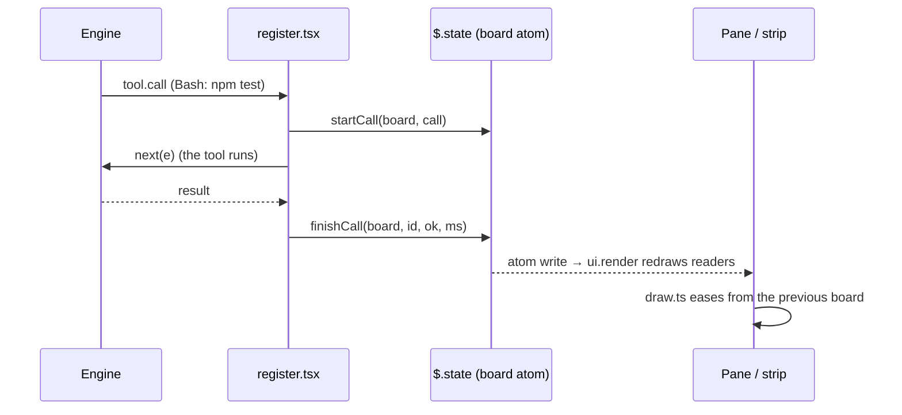

# Architecture

Embermeter is one Claude Code hooks module, split into layers so the parts that matter can be tested without the engine.

```
hooks/register.tsx      engine wiring      every event hook, sensors, guards, commands
        │  Board (immutable value)
        ▼
hooks/core.ts           state + analytics  pure functions, no I/O
        │  Board + Cfg
        ├──────────────────────────────┐
        ▼                              ▼
hooks/draw.ts           SVG pages      hooks/term/pages.ts      terminal pages (coloured segments)
                                               ▼
                                       hooks/term/raster.ts     cells, theme colours, motion, base64
                                               ▼
                                       hooks/term/view.tsx      Raster blocks + the frame loop ($.ui.blit)
```

## Data flow



1. **Events in.** `register.tsx` listens to `prompt.submit`, `turn.start`, `turn.complete`, `tool.check`, `tool.call`, `agent.spawn`, `session.measure` and `session.compact`. Each handler maps the event to one `core.ts` transition (`startCall`, `endTurn`, `spawnAgent`…) and writes the new board to the `board` atom.
2. **Sensors.** One `$.clock.every` timer. Sensors (`/sys`, `/proc`) are sampled every 5 seconds. The clock ticks every second only while a turn or a subagent is running. The context breakdown (`session.usage({ breakdown: 'summary' })`, a local estimate) is refreshed at most every 15 seconds, and always after a turn or a compaction.
3. **Render.** `ui.render` hooks for `Pane` and `AbovePrompt` read the atom, so any write redraws them. `register.tsx` keeps the previously drawn board for each site, and `draw.ts` uses it to ease values from the old reading to the new one.

## State

`types/index.d.ts` declares the contract: `PluginState.embermeter = { board, tab }`. The board is a plain, immutable value. Every transition returns a new board.

Lists are capped, so a long session stays flat in memory:

| List | Cap |
|---|---|
| calls | 60 |
| log | 60 |
| context history | 60 |
| activity buckets (per minute) | 60 |
| thermal history | 90 |
| turns | 40 |
| agents | 40 |
| durations per tool (for p95) | 50 |
| models | one entry per model used |
| rate-limit readings | 30 per window, reset when the window does |
| days in the lifetime store | 60 |

`normalize()` fills in any field missing from a board stored by an older version. That way, after an upgrade, a hot reload or a resumed session never crashes on an old shape.

Lifetime totals (`sessions`, `turns`, `calls`, `usd`), the same four totals per local calendar day (the last 60 days), the last 20 sessions, spend per branch and each MCP server's run of unused sessions (the 40 most recent of each) are the only values kept across sessions, in `$.store`.

## Analytics

| Signal | How it's computed |
|---|---|
| **Runway** | Average context growth of the last 6 turns that grew, then `(ceiling − now) / burn`. The ceiling is the auto-compact threshold when it's on, otherwise 100%. |
| **Health** | Starts at 100. Loses points for context above 60% (up to 30), tool errors above 5% (up to 25), temperature near or over the limit (10 or 20), denials (up to 10), a rate limit over 80% (15), going over budget (10), and a loop (15). Grades: A ≥ 90, B ≥ 75, C ≥ 60, D ≥ 45, otherwise F. |
| **Cost rate** | Session cost divided by elapsed hours, and the average cost of the turns that have one. |
| **Cache hit** | `cacheRead / (input + cacheRead + cacheWrite)`. |
| **Throughput** | Output tokens divided by turn time, over the last 8 turns. |
| **p95** | 95th percentile of the last 50 durations of each tool. |
| **Budget runway** | `(budget − cost) / average cost per turn`, rounded down. |
| **Loop watch** | The same call (tool and input) three times back to back, or the same call failing three times in the last 12 calls. Subagent calls and calls without an input are left out, and so is Read from the back-to-back rule, because paging through one large file repeats the path. |
| **Context fed by tools** | The text each tool's result handed the model, at about four characters per token. An estimate: good for ranking tools, not for billing. |
| **Model split** | Each finished turn adds its cost, input (fresh + cache) and output tokens to the model that answered it. |
| **Rate-limit forecast** | Each window's readings are kept while its reset time stays the same, and only when the reading moves. The pace is the first-to-last slope; a window gets a time to full only when it is filling, the readings span at least five minutes, and it fills before it resets. |
| **Compaction warning** | Fires when the runway reaches two turns or fewer and auto-compact is on. |
| **Daily budget** | Today's spend comes from the per-day totals in the lifetime store. The alert keys carry the date, so each day alerts afresh. |
| **Long turn** | Fires once per turn when it runs past `longTurnMin`, naming the last tool call. |
| **Heaviest files** | Each call keeps the file it worked on, so the size of its result is credited to that file. |
| **Week over week** | Spend over the last seven calendar days against the seven before. |
| **Branch** | Read from `.git/HEAD` under the project root at most every 15 seconds, idle or not. A worktree's `.git` file is followed to the real git directory. |
| **Cache warmth** | The last reply's time plus the cache lifetime, against now. The lifetime is 5 minutes until a reply after 5–60 idle minutes rewrites under half the window, which shows an hour-long cache. A turn whose window shrank (a compaction rewrites only the shorter prompt) proves nothing. |
| **Loaded, never called** | Loaded MCP tools grouped by server (`mcp__<server>__` prefix) against the calls made to that prefix. The lifetime store keeps each server's run of sessions without a call. |
| **Same tokens, cheaper model** | Each main-thread turn's tokens times list prices kept in `core.ts`; Haiku's 5x rate above 100k tokens is applied by the window size at the turn's end. Turns that overlapped a subagent's start are left out. |
| **Last compaction** | On a main-conversation compaction (not `precompute`, not skipped): `tokensBefore`, `tokensAfter`, and what fed the window since the previous one. Where the `session.compact` hook never runs (a managed plugin seated outermost can send it past), a context sample that falls to half or less from 20k tokens or more counts as one, recorded as `detected`. |
| **Test runs** | Bash commands whose command word (a path's last part) names a test runner, or a runner's subcommand does (`npm test`, `node --test`, `./gradlew test`, `bundle exec rspec`); the shell's own `test` does not count. Counts come from RSpec's or PHPUnit's totals, else the output's "Tests" total line, else summed across it; a pytest error counts as a failure. A run that exits non-zero records at least one failure. |
| **Background jobs** | Opened by a main-thread Bash result's `backgroundTaskId`, unless the result says no notification can follow (`backgroundEndsWithFinalResponse`) or that its subagent is woken instead (`backgroundWakesOwner`). Closed by `TaskStop`, or by each `<task-notification>` in a prompt that names the task. The System tab's lines move only while a turn runs. |
| **Since the last commit** | The mtime of the branch's reflog, else its ref, else `logs/HEAD`, checked with the branch every 15 seconds at most; files under the project root with an Edit or Write that ran (not denied, not failed) after it. |
| **Branch spend** | Each turn's cost added to the session's branch in the lifetime store, the 40 most recent kept. |
| **Alerts** | Each threshold fires once. The context alerts re-arm after a compaction. Budget alerts fire at 50%, 80% and 100%. Each distinct loop alerts once. In quiet hours the toast is held, but the alert is still logged. |

## Heat guard

A second `tool.call` hook, matched on `Bash` only:

1. If `guard` is off or the command doesn't match `heavyPattern`, the call passes.
2. `refuse(vitals, cfg)` checks the **last cached** sensor reading. The guard never reads the disk on the tool path.
3. If the CPU is over `maxTempC`, or the battery is discharging below `minBatteryPct`, the call is denied with a message that tells Claude to wait or ask the user.

Temperature comes from CPU sensors first (`x86_pkg_temp`, `TCPU`, `coretemp`, `k10temp`, `cpu-thermal`). It falls back to the hottest zone only when none of those exist, because ACPI and Wi-Fi zones often report trip points rather than die temperature. The default heavy pattern matches whole command words, never parts of paths or flags.

## Rendering

- **Surfaces.** VS Code and the desktop app draw SVG (`Svg` element). The desktop draws it interactive, so turn bars carry hover tooltips; VS Code draws an image, so every value is also printed. The terminal has no `Svg`, though `$.ui.resolve` still returns one that renders nothing, so the pane picks its drawing by `e.surface`, never by the element's presence.
- **Terminal.** Each tab is a list of lines of coloured segments (`term/segments.ts`), split into blocks at each title. Titles are ruled to the body width when the page is laid out. Each block is one `Raster`: `raster.ts` packs every cell as three little-endian u32s (code point, foreground, background), with theme colours as mid tones that read on dark and light terminals and the terminal's own foreground for plain text. Gradient tones (`heat`, `fade`, `cool`) colour each cell by its place along the run; a `pill` segment paints its tone as the background under dark text. Any code point a Raster would refuse becomes `?`, and every line is clipped to the body width with `…`, so no input can blank a tab.
- **Terminal motion.** Segments may carry `spin`, `pulse` or `flow`. Blocks with motion are kept in a frame table; a 140 ms timer re-encodes them at the next phase and repaints them with `$.ui.blit`, never a full redraw. A block that is no longer mounted answers `deny` and leaves the table, and only live work emits motion, so the loop sends nothing while idle.
- **Motion** is SMIL only, with no script: `ease()` animates from the previous value with an ease-out-quint spline. Loops (particles, pulses, breathing) are emitted only while their stage is active, and only with `motion: smooth`.
- **Layout.** `drawContext(cfg, prev, columns)` picks a 640 px canvas at 76 columns or more, otherwise 400 px. Every page lays itself out for both widths.
- **Safety.** `txt()` is the only place text enters SVG, and it escapes `& < > "`.

## Testing

- `tests/core.test.ts` covers every analytic and transition in `core.ts`.
- `tests/instruments.test.ts` covers cache warmth, idle MCP servers, the model what-if, test parsing, background jobs, branch spend and the since-commit count.
- `tests/draw.test.ts` draws the Spend, Tools and Context pages at both widths and checks that user text arrives escaped.
- `tests/term.test.ts` checks the cell encoding byte for byte, glyph safety, meter precision, heat colours, motion frames and that every page fits the narrowest width.
- `tests/pane.test.tsx` mounts the real module on the `vscode`, `desktop` and `terminal` surfaces against a stub engine, decodes the terminal's Raster cells, and drives the guards and `/embermeter export` through the real hooks.
- `scripts/render-docs.ts` renders every page from a fixed sample session. CI runs it as a smoke test, and contributors use it to refresh the README images.
